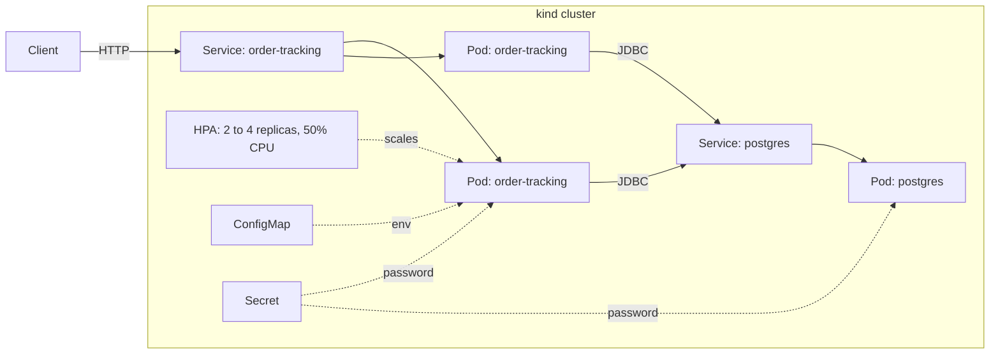

# Order Tracking Service

A small REST service for managing customer orders, built with **Spring Boot** and **PostgreSQL**, packaged with **Docker**, and deployed on **Kubernetes** (local `kind` cluster). I built it to practice the deployment side of backend engineering: containerization, health probes, autoscaling, and rolling updates with rollback.

## Architecture



## Tech stack

- Java 17, Spring Boot (Web, Data JPA, Validation, Actuator), Gradle
- PostgreSQL 16
- Docker (multi-stage build)
- Kubernetes via kind, kubectl, metrics-server

## API

| Method | Path | Description |
| --- | --- | --- |
| POST | `/orders` | Create an order (`customerName` and `item` required) |
| GET | `/orders` | List all orders |
| GET | `/orders/{id}` | Get one order (404 if missing) |
| PUT | `/orders/{id}/status` | Update status: `CREATED`, `SHIPPED`, `DELIVERED`, `CANCELLED` |
| DELETE | `/orders/{id}` | Delete an order (404 if missing) |
| GET | `/version` | Returns the running app version |
| GET | `/actuator/health` | Health endpoint used by the probes |

## What the Kubernetes setup demonstrates

- **Secret and ConfigMap:** the database password lives in a Secret; the connection URL and username live in a ConfigMap.
- **Readiness and liveness probes:** a new pod receives no traffic until its readiness probe passes.
- **Replicas and self-healing:** 3 replicas behind one Service; a deleted pod is replaced automatically.
- **Autoscaling:** a Horizontal Pod Autoscaler (2 to 4 pods, 50% CPU target) scaled the app from 3 to 4 pods under load generated with a busybox pod.
- **Rolling update:** moved from image `0.1` to `0.2` with no downtime.
- **Rollback:** deployed a non-existent image tag, confirmed the old pods kept serving traffic, then recovered with `kubectl rollout undo`.

## Run it locally

Prerequisites: Docker Desktop, `kind`, `kubectl`, Java 17.

```bash
# 1. Build the image (multi-stage: compile in a JDK image, run in a JRE image)
docker build -t order-tracking:0.2 .

# 2. Create a cluster and load the image into it
kind create cluster --name orders
kind load docker-image order-tracking:0.2 --name orders

# 3. Deploy the database, then the app
kubectl apply -f k8s/postgres.yaml
kubectl get pods            # wait until postgres is 1/1 Running
kubectl apply -f k8s/app.yaml

# 4. (Optional) autoscaling needs metrics-server
kubectl apply -f https://github.com/kubernetes-sigs/metrics-server/releases/latest/download/components.yaml
#    On kind, add the --kubelet-insecure-tls argument to the metrics-server deployment, then:
kubectl apply -f k8s/hpa.yaml

# 5. Reach the service
kubectl port-forward service/order-tracking 8080:80
```

Try it (PowerShell):

```powershell
Invoke-RestMethod -Method Post -Uri http://localhost:8080/orders `
  -ContentType "application/json" `
  -Body '{"customerName":"Asha","item":"Keyboard"}'
Invoke-RestMethod http://localhost:8080/orders
```

Or with curl:

```bash
curl -X POST localhost:8080/orders -H "Content-Type: application/json" \
  -d '{"customerName":"Asha","item":"Keyboard"}'
curl localhost:8080/orders
```

## Roll out a new version and roll it back

```bash
kubectl set image deployment/order-tracking order-tracking=order-tracking:0.2
kubectl rollout status deployment/order-tracking

kubectl rollout history deployment/order-tracking
kubectl rollout undo deployment/order-tracking
```

## Project layout

```
src/main/java/...   Spring Boot application (entity, repository, controllers)
Dockerfile          multi-stage build
k8s/postgres.yaml   Secret, Deployment, Service for PostgreSQL
k8s/app.yaml        ConfigMap, Deployment (probes, resources, replicas), Service
k8s/hpa.yaml        Horizontal Pod Autoscaler
```

## Known limitations and next steps

- PostgreSQL runs as a single pod with no persistent volume, so data is lost if the pod is recreated. A PersistentVolumeClaim or StatefulSet is the next improvement.
- The database password is stored in plain form in `k8s/postgres.yaml` for local development only. A real deployment would use a secrets manager.
- Schema is generated by Hibernate (`ddl-auto=update`); a migration tool such as Flyway would be the production approach.
- No ingress, authentication, or automated tests yet.
